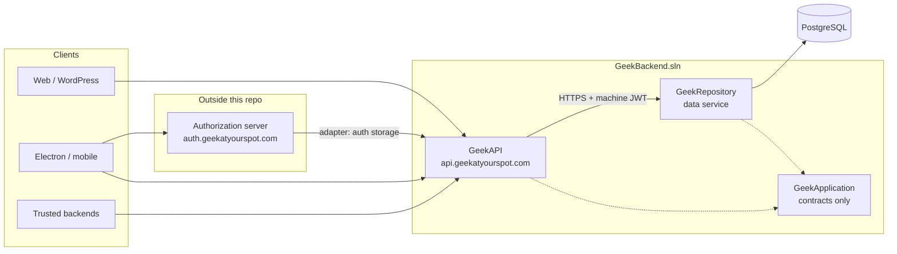

# GeekBackend Architecture

GeekBackend is the **platform data gateway and data plane** for Geek products: shared content, and the backend of each product that lives here (Content Creator, Geek-Crawler, GTM, Visitors, Geek-Social, Geek-CRM). It is **not** an authorization server. User login is **GeekOAuth** (`auth.geekatyourspot.com`). This repo ships two HTTP services and one shared contracts library.

**2026-05-30 (platform decoupling):** Legacy **GeekAPI `/api/auth/*`**, **SyncHub**, and **GeekRepository `repo/auth/*`** are **removed** from code; legacy **auth DB tables** dropped via migration `0006`. GeekAPI exposes **SEO internal proxy** (`/api/seo/internal/*`), **content** APIs, and health. Identity: **GeekOAuth**. See Geek-SEO `plan-documents/PLATFORM-DECOUPLING.md`.

---

## Platform topology



| Role (OAuth vocabulary) | Deployment | Responsibility |
|-------------------------|------------|----------------|
| **Authorization server** | `auth.geekatyourspot.com` (separate .NET service) | Issue tokens, OIDC discovery, login UI, client registry |
| **Resource server (platform API)** | GeekAPI | API-key gate; each product's `/api/<product>/*` routes; public content reads; no legacy `/api/auth/*` |
| **Resource server (data)** | GeekRepository | All PostgreSQL reads/writes; no product-facing HTTP except from GeekAPI |
| **Client** | Each Geek product | OIDC against auth; **never** call GeekRepository directly |

**Hard rules**

1. **Only GeekAPI talks to GeekRepository** — no product service (OrderStack, RankPilot, etc.) holds `REPO_URL` or database credentials for platform auth/content.
2. **No authorization server in GeekBackend** — no `/connect/*`, no OpenIddict issuer on GeekAPI.
3. **Geek-SEO is not part of this data plane.** Geek-SEO was never an authorized service (Jeff, 2026-09-29). Its persistence layer (`SeoDbContext`, `repo/seo/*`, the `geek_seo` schema) was removed from GeekRepository, and nothing here is project-referenced to it or calls it: the rule is "copy, never reuse". See `docs/geekseo-repository-schema.md` (retired).
4. **Long-running work uses push, not poll.** Job and crawl progress is delivered over **SignalR hubs on GeekAPI** (or Geek-SEO hubs for site analysis). Clients subscribe via hub `Join*` methods; REST GET is for snapshot, history, and reconnect catch-up only — **never on a timer**. Workers wake on `NOTIFY`/channel events with one-shot orphan recovery on startup — no continuous `SELECT pending` tickers. See [`content-creator-v2/plan/realtime-progress.md`](../content-creator-v2/plan/realtime-progress.md) and [`content-creator-v2/plan/correctness-and-fallbacks.md`](../content-creator-v2/plan/correctness-and-fallbacks.md).
5. **Correctness over expediency.** No silent fallbacks; jobs must fail loud or reach a terminal/awaiting state.

**SignalR hubs (GeekAPI)**

| Product / flow | Hub | Event |
|----------------|-----|-------|
| Content Creator v2 jobs | `/hubs/gcc-v2-realtime` | `JobEvent` |
| Partner crawl (Geek-Crawler) | `/hubs/geek-crawler-realtime` | `GeekCrawlerEvent` |
| Workflow tools generation | `/hubs/workflow-realtime` | `ToolsJobEvent` |

Site analysis progress: Geek-SEO `/hubs/seo-realtime` (`AnalysisProgress`).

Geek-Crawler is a **standalone product**: started from the Geek-Crawler UI only. Content Creator v2 does **not** start, gate on, or read Geek-Crawler runs.

Legacy gcc-v2 `JoinCrawlRun` / `CrawlEvent` for tool-source crawl is **removed** with that stack — not a product surface.

---

## Solution layout

```
GEEKBACKEND.slnx
├── GeekApplication     Class library — entities, interfaces, Result<T>, auth helpers (no HTTP, no DB)
├── GeekAPI             Web app — platform gateway (Railway: api.geekatyourspot.com)
└── GeekRepository      Web app — universal data service (Railway: GeekRepository project)
```

### Project references (compile-time)

```
GeekAPI        → GeekApplication only
GeekRepository → GeekApplication only
GeekApplication → (no project references)
```

GeekAPI **must not** reference GeekRepository. All data access is **HTTP** from GeekAPI HttpClients to GeekRepository controllers.

---

## GeekAPI (today)

**Purpose:** Platform API **gateway** — product routes, public content reads, health. **Not** an authorization server; **not** legacy auth storage (retired May 2026).

| Surface | Auth | Notes |
|---------|------|--------|
| `/api/seo/internal/*` | `X-API-Key` + optional user headers | Forwards to `repo/seo/*`, which GeekRepository no longer serves (persistence retired 2026-09-29); the controller is left to a separate decision |
| `/api/case-studies`, `/api/departments`, `/api/use-cases` | Public read | Marketing/content |
| `/api/receptionist/twilio/*` | `X-Twilio-Signature` (exempt from `X-API-Key`) | Geek-Receptionist missed-call text-back; see [`docs/Geek-Receptionist.md`](docs/Geek-Receptionist.md) |
| `/api/crm/*` | `X-API-Key` | Geek-CRM (`geek_crm` via `repo/crm/*`); see [`docs/GEEK-CRM-DATA-MODEL.md`](docs/GEEK-CRM-DATA-MODEL.md) |
| `/api/auth/*`, `/hubs/sync` | — | **410 Gone** (use GeekOAuth) |

**Outbound:** `HttpClient` `GeekRepository` → `REPO_URL` with a short-lived ES256 token GeekAPI signs per request (`GEEK_API_REPOSITORY_SIGNING_KEY`); GeekRepository verifies it with `GEEK_API_PUBLIC_KEY` and accepts nothing else.

**Does not:** Issue tokens, host login UI, or run Geek SEO product logic.

**Product logic hosted here by decision:** Geek-Receptionist was merged into GeekAPI on 2026-11-10 (Jeff) rather than run as its own Railway service, and stays there (Jeff, 2026-11-20). It is multi-tenant: a business's settings live in `geek_voice` and are answered on the signup form, and the single-business path that read them from the environment was deleted on 2026-11-20. If it gains persistence, that goes in a `geek_voice` schema in GeekRepository, reached over HTTP like everything else.

---

## GeekRepository (today)

**Purpose:** The data plane. Shared content tables, and one schema per product that lives in GeekBackend. No legacy platform auth tables after migration `0006`, and no `geek_seo`.

| Access style | Schemas | Tooling |
|--------------|---------|---------|
| EF (`AppDbContext`) | `departments`, `case_studies`, `use_cases`, … | Platform content migrations |
| EF (product contexts) | Content Creator and the content-writer stores | Per-context EF mapping |
| EF mapping over raw SQL scripts | `geek_gtm`, `geek_visitors`, `geek_social`, `geek_crm` | `Migrations/Sql/*.sql`, applied by `SqlMigrationRunner` (it records script names, not hashes) |

Controllers use **InternalService** policy (the signed GeekAPI token, `internal.api` scope).

---

## Service-to-service auth: GeekAPI to GeekRepository

GeekRepository answers only GeekAPI, by proof of identity (Jeff, 2026-11-23). There is no shared key.

| Property | Value |
|----------|--------|
| Token | ES256 (ECDSA P-256) JWT, signed by GeekAPI per request, valid 60 seconds, unique `jti`, replay refused |
| `iss` / `aud` | `geek-api` / `geek-repository` |
| Signing key | `GEEK_API_REPOSITORY_SIGNING_KEY` on GeekAPI only (base64 PKCS#8) |
| Verification key | `GEEK_API_PUBLIC_KEY` on GeekRepository only (base64 SubjectPublicKeyInfo) |
| Scope | `internal.api` |
| Refusals | unsigned, other algorithm or curve, other issuer or audience, expired, minted with a life over 120 seconds, no `jti`, no `iat`, replayed |
| Startup | each service refuses to start without its key; a key that is not on the P-256 curve is refused |

No header other than a valid `Authorization: Bearer` opens any route; `X-Repo-Key` and `X-Internal-Api-Key` are gone. A compromised GeekRepository holds only the public key and cannot mint requests. Not in the token: method, path or body binding, and the replay guard is per instance (enough while GeekRepository runs one instance). Record: `Geek-Receptionist/plans/credential-rotation-and-exposure-fix.md` (Phase 2).

---

## External authorization server (GeekOAuth)

Lives **outside** this repository (`GeekOAuth` repo). Responsibilities:

- OIDC/OAuth 2.1 for Geek apps (PKCE public clients, M2M `geekapi`, etc.)
- User credentials in **geek_oauth** database (`asp_net_users`) — **not** platform `public.users`

GeekBackend **does not** store or expose login APIs after M4–M6/O2.

---

## Data boundaries

### Content (GeekAPI + GeekRepository)

- Departments, case studies, use cases — public read via GeekAPI; writes via authenticated platform routes as products require

### Product pattern (the default for every new product)

Decided Nov 11, 2026 (Jeff) and the one the code already enforces for Content Creator, GTM, Visitors, Geek-Social and Geek-CRM:

1. **The backend stays in GeekBackend under strict product boundaries.** Each product has its own contracts (`GeekApplication/Models/<Product>`, `Interfaces/<Product>`), its own schema (`geek_<product>`) with its own numbered range of SQL scripts, its own DbContext and repository in GeekRepository (`repo/<product>/*`), and its own routes in GeekAPI (`/api/<product>/*`). It never reads or writes another product's tables; other products reach its data only through its contracts.
2. **The UI is its own repository** (a Next.js app such as `geek-social`) with no database and no credentials of its own. It signs in through GeekOAuth and calls GeekAPI.
3. **GeekAPI is the only path to GeekRepository** (hard rule 1). A product that is split out later still routes through GeekAPI, so there is no new Railway service per product.
4. **A canonical contract per product** where the product is sold or shared (Geek-CRM: `GeekApplication/Schemas/GeekCrm.xsd`), kept equal to the database and the code by tests.

Sellability comes from the boundaries: a clean copy-out stays possible ("copy, never reuse").

### Out of scope for GeekBackend

- Geek-SEO product logic and persistence (providers, workers, `/api/seo` product routes, the `geek_seo` schema).
- Product UIs, which live in their own repositories.

---

## Deployment (Railway)

| Service | Project | Public host |
|---------|---------|-------------|
| GeekAPI | GeekAPI | `api.geekatyourspot.com` |
| GeekRepository | GeekRepository | `geekrepository-production.up.railway.app` (or custom domain) |

### Environment variables

**GeekAPI**

| Variable | Purpose |
|----------|---------|
| `REPO_URL` | GeekRepository base URL |
| `GEEK_BACKEND_API_KEY` | Inbound trust for auth-storage and admin adapters |
| `CORS_ORIGINS` | Browser origins allowed to call API |
| `PORT` | Listen port |
| Geek-Receptionist variables | The complete list of Railway environment variables for Geek-Receptionist (and the migration mapping from deprecated single-tenant v0 variables) is documented in [`docs/Geek-Receptionist.md`](docs/Geek-Receptionist.md) (Section 8). |

**GeekRepository**

| Variable | Purpose |
|----------|---------|
| `DATABASE_URL` | PostgreSQL (Supabase/Railway) |

**Target additions (replace repo API key)**

| Variable | Service | Purpose |
|----------|---------|---------|
| `AUTH_SERVER_URL` | GeekRepository (and GeekAPI token client) | Issuer URL for JWT validation / token acquisition (`https://auth.geekatyourspot.com`) |
| `GEEKAPI_CLIENT_ID` / secret | GeekAPI | Machine client for `client_credentials` (names illustrative; use platform secret store) |

**Remove from Railway when JWT S2S is live**

- `OPENIDDICT_*`, `GEEK_*_CLIENT_SECRET` (issuer-era), `AUTH_SERVER_URL` pointing at **api** as issuer, `GEEK_SEO_*`

---

## Security principles

1. **Short-lived, audience-bound tokens** for machine access — not shared passwords in headers.
2. **Least privilege** — `internal.api` only on repo; product scopes only on user tokens from auth.
3. **Single data path** — GeekAPI → GeekRepository; products do not hold DB URLs for platform data.
4. **Secrets in platform vault** — Railway variables or external secret manager; never commit; rotate on leak.
5. **`GEEK_BACKEND_API_KEY`** is for **trusted backends calling GeekAPI** (e.g. auth adapter). It is separate from repo S2S and must not be confused with user sessions.

---

## Database cleanup (OAuth / OpenIddict era)

On startup, `SqlMigrationRunner` applies `Migrations/Sql/0004_drop_oauth_openiddict_and_adapter_storage.sql` (issuer-era tables only). **Greenfield:** the external authorization server owns client/token persistence; this database holds platform content and the product schemas listed above. The `geek_seo` scripts (`0005`, `0007` to `0014`) remain in the folder as history; GeekRepository no longer maps or serves that schema.

---

## Testing

```bash
dotnet build GEEKBACKEND.slnx
dotnet test GEEKBACKEND.slnx
```

Integration tests generate a fresh signing key pair per run (`GeekApiTestFactory`); no key is committed.

---

## Related docs

- [README.md](./README.md) — build, run, status table
- [GeekAPI/README.md](./GeekAPI/README.md) — GeekAPI routes and env (update when JWT S2S lands)
